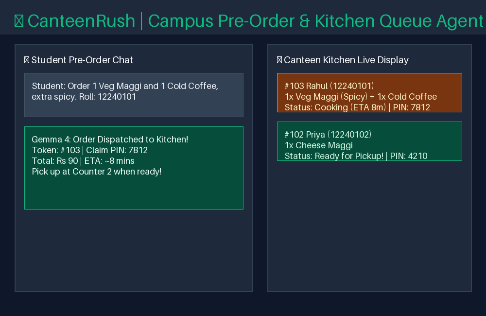

# CanteenRush: Autonomous Campus Pre-Order & Kitchen Queue Agent

> **Built for OpenLake × MLH Hack Day · IIT Bhilai · Build with Gemma 4**  
> Eligible for both **Best Use of Gemma 4** and **Best Open-Source AI Project**.



---

## The Problem

During peak 15-minute breaks between lectures at college, over 100 students rush to the canteen at the same time. Long standing lines take 20–25 minutes, forcing students to either skip meals or run late to their next lecture.

## The Solution

**CanteenRush** is an intelligent conversational campus dining agent powered by **Gemma 4 (`gemma-4-26b-a4b-it`)** through the Gemini API. Students can pre-order food using natural language directly from their lecture halls.

The agent:
1. **Verifies Campus Roll Numbers** against the institutional student database to eliminate fake orders and enforce a strict 1-active-order limit.
2. **Calculates Exact Bills & Prep Times** using custom canteen menu tools.
3. **Dispatches Directly to the Kitchen Display**, generating a **Token ID** and a secret **4-digit Claim PIN** for zero-cost pickup verification.
4. **Shows Real-Time Queue Status**, letting students arrive precisely when their meal is ready without waiting in line.

---

## Model & Integration

* **Model Used**: `gemma-4-26b-a4b-it` (Google DeepMind's Mixture-of-Experts architecture: 26B total parameters with 4B active parameters per token for low-latency responses).
* **API Integration**: Called through the official Gemini API (`google-genai` SDK) via `gemma_client.py`:

```python
# gemma_client.py (line 203)
response = client.models.generate_content(
    model="gemma-4-26b-a4b-it",
    contents=contents,
    config=config
)
```

The conversational agent in `harness/agent.py` coordinates autonomous tool calling using:

```python
# harness/agent.py (line 35)
response = gemma_client.generate_raw(self.history, config)
```

---

## Agent Skill (Open Standard Compliant)

This project includes a fully compliant Agent Skill under the **Agent Skill Open Standard** located at:
`skills/canteen-preorder/SKILL.md`

### Registered Tools (`harness/tools.py`):
* `get_canteen_menu(category)`: Fetches live menu items, prices, and prep times.
* `verify_student(roll_number)`: Authenticates student against campus roster.
* `check_kitchen_queue()`: Computes active kitchen orders and wait times.
* `place_canteen_preorder(student_roll, items_summary, special_instructions, total_bill)`: Commits ticket to live kitchen board.
* `calculator(expression)`: Deterministic math for pricing calculations.

---

## How to run

### 1. Prerequisites
Ensure you have Python 3.10+ installed and activate your virtual environment:

```bash
# In the project directory:
source ../gemma4-starter/.venv/bin/activate
# or install dependencies:
pip install -r requirements.txt
```

### 2. Configure Environment
Create a `.env` file with your Gemini API key (from [aistudio.google.com](https://aistudio.google.com)):

```bash
GEMINI_API_KEY="your-gemini-api-key-here"
```

### 3. Launch Application
Run the Gradio app:

```bash
python app.py
```

Open your browser at: **`http://127.0.0.1:7860`**

* **Tab 1 (📱 Student Pre-Order Assistant)**: Chat with Gemma 4, customize orders, and receive your Token + Claim PIN.
* **Tab 2 (🍳 Canteen Kitchen Live Board)**: Live counter view for canteen staff with real-time order status and `[Mark Ready]` buttons.
* **Tab 3 (📋 Canteen Menu)**: Official IIT Bhilai canteen menu and price card.

---

## Verification & Testing

To run the submission validator:

```bash
python tools/check_submission.py
```

---

## License

This project is licensed under the [MIT License](LICENSE).
